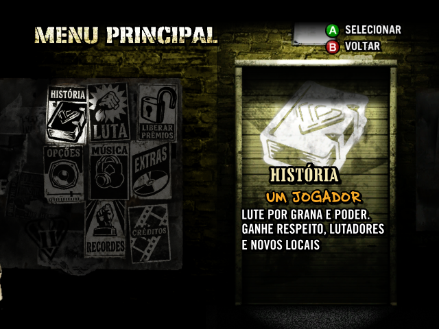
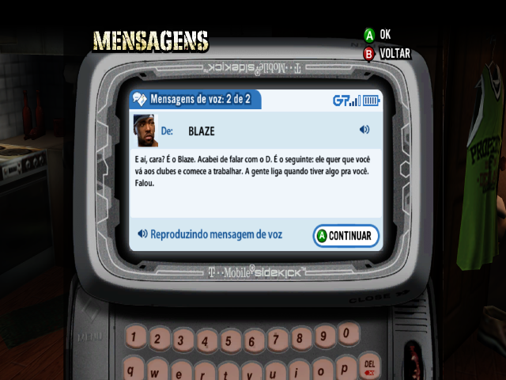

# Def Jam: Fight for NY em português brasileiro

Tradução de fãs para **Def Jam Recompiled no Windows**. O pacote traduz menus, textos da interface, tutoriais, mensagens do celular e legendas da história. As vozes são as originais.

## Download

Na aba [Releases](../../releases), baixe **`DefJam_PTBR_v2.2.1.zip`** entre os arquivos da versão `v2.2.1`.

## Sobre os testes

A tradução foi testada em partes do jogo. Ainda não joguei todas as rotas da história nem conferi todos os diálogos. Por isso, algumas falas podem estar sem legenda, e ainda pode haver erros de tradução ou problemas de formatação.

Se encontrar algum problema, abra uma **Issue** aqui no GitHub e diga em qual luta, cena ou menu aconteceu. Se puder, mande uma captura de tela.

## Instalação

Você precisa do Def Jam Recompiled instalado e da sua própria cópia do jogo.

1. Feche o jogo e extraia o ZIP.
2. Copie a pasta `ptbr-completo` para `data/mods` dentro da instalação do Recomp.
3. Abra o launcher e, em **Mods**, ative **Português brasileiro - Textos e história**.

No celular do jogo, abra **Mensagens**, selecione um áudio e aperte **Ouvir** para ler o texto em português no aparelho.

### Legendas antes e depois das lutas

Essas falas usam a mesma fonte, o mesmo contorno e a mesma posição das legendas das cutscenes. A extensão foi testada com o **Recomp 1.1.1 para Windows**. Para habilitá-la, feche o jogo e execute `Instalar-Legendas.ps1` na pasta `ptbr-completo`. O script usa o Python e as ferramentas de compilação do Recomp e guarda o executável anterior em `data/backups`.

A exibição dessas legendas depende do reconhecimento do áudio. Em uma das rodadas de teste, uma fala de entrada passou sem legenda.

## Capturas

## Créditos

- Curadoria e testes da tradução PT-BR por Tsumaru89, com apoio do Codex na tradução e na implementação do mod.
- Projeto base e formato do pacote de idioma. [Def Jam Recompiled](https://github.com/vyanhursky/DefJamFFNY-recomp)
- Referência técnica para a interface e as legendas da abertura. [Tradução espanhola de ZARF](https://github.com/MODZARF/Parche-textos-en-espanol-DJFFNY-Compatible-con-Xbox-360)
